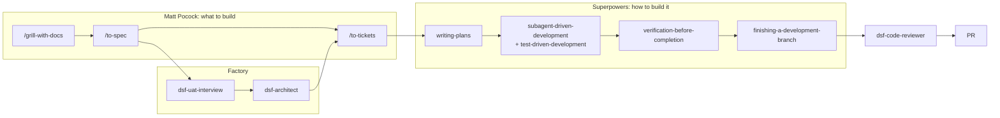

# dsf-hybrid workflow

The recommended starting point. It combines the two packs where each is strongest: [Matt Pocock's skills](https://github.com/mattpocock/skills) to get requirements and module design right, and [Superpowers](https://github.com/obra/superpowers) to execute them with strict TDD and a fresh subagent per task.

## How a feature flows

1. `make design`, then `/grill-with-docs` with your vision; `/to-spec` writes `specs/prd.md`.
2. UAT interview and architecture (`dsf-uat-interview`, `dsf-architect` with `/codebase-design`).
3. `/to-tickets` splits the spec into tracer-bullet tickets in the task backend.
4. `make build`, pick a ticket: `writing-plans` plans it, `subagent-driven-development` executes it test-first in a worktree.
5. `verification-before-completion` runs `make check`; `finishing-a-development-branch` opens the PR; `dsf-code-reviewer` reviews it.

Full step-to-skill mapping and the rules for where the packs overlap: [.dsf/CLAUDE.workflow.md](../../.dsf/CLAUDE.workflow.md).

## Why this combination

| Need | Best pack | Why |
| --- | --- | --- |
| Unambiguous requirements | Matt Pocock | `/grill-with-docs` interviews hardest and records terms and decisions as it goes. |
| Agent-sized work items | Matt Pocock | `/to-tickets` makes thin vertical slices with explicit blocking edges. |
| Module design | Matt Pocock + factory | deep-module vocabulary plus enforced module rules and metrics. |
| Reliable execution | Superpowers | fresh subagent per task, strict red-green-refactor, review between tasks. |
| Not claiming false success | Superpowers + factory | `verification-before-completion` plus the Stop hook's `make check`. |

The cost is two packs to keep current, and an overlap that the mapping must keep settled (brainstorming vs grilling, two TDD skills).

## Installing and upgrading

Claude Code offers to install both plugins the first time it starts in the repo (from `.dsf/settings/workflow.json`). Upgrade with `/plugin` → Marketplaces → update, then run the factory benchmark ([docs/dsf/factory-evolution.md](../dsf/factory-evolution.md#benchmark)).
